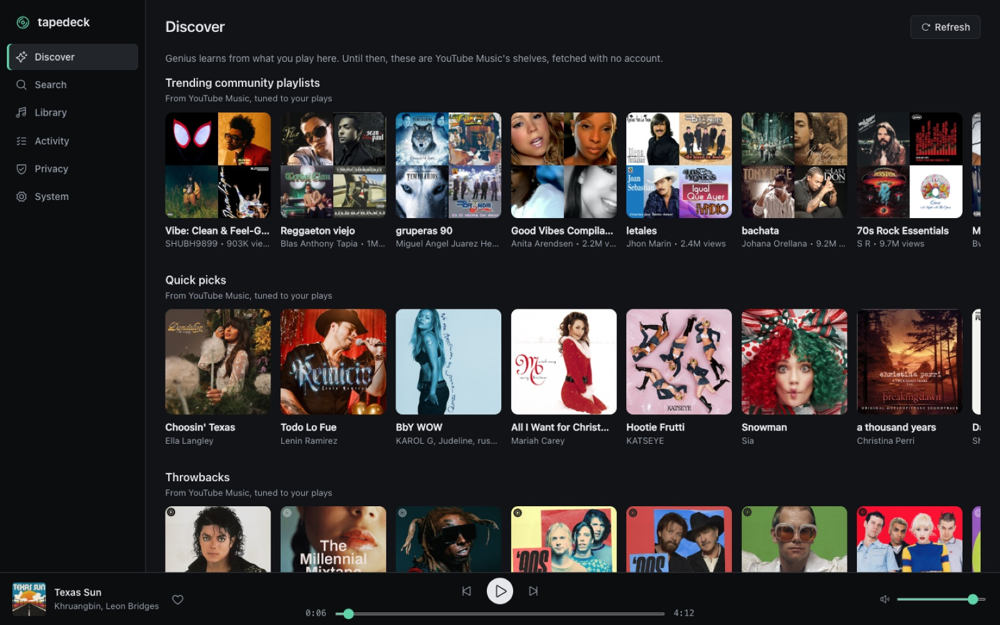
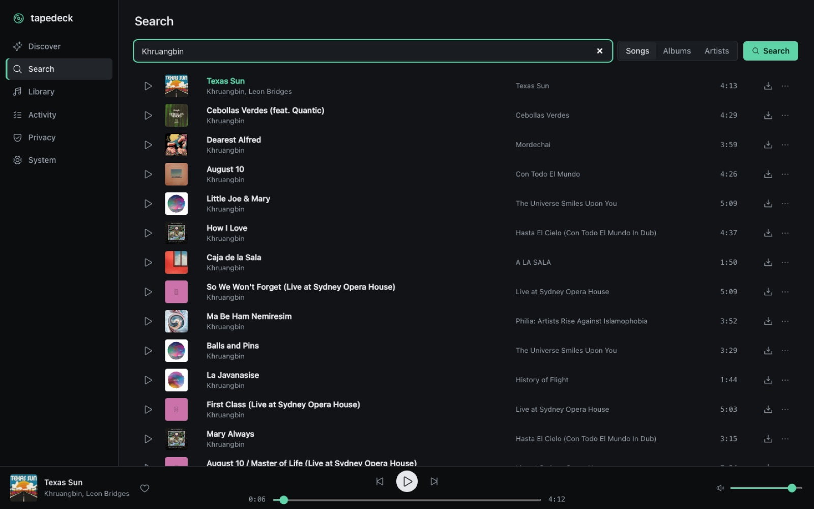

<div align="center">

# tapedeck

**A self-hosted music backend for YouTube Music and Spotify. Search, stream and download into Navidrome. No Google or Spotify account needed.**

[](https://www.python.org/)
[](https://docs.astral.sh/uv/)
[](https://modelcontextprotocol.io/)
[](https://www.navidrome.org/)
[](LICENSE)



</div>

tapedeck works like Sonarr or Lidarr, but for single songs and albums you pick yourself. You search the YouTube Music catalog or paste a Spotify link. You play the song right away. If you want to keep it, tapedeck saves a tagged `.m4a` with cover art into the folder your [Navidrome](https://www.navidrome.org/) server reads. Then it shows up in every Subsonic app you already use.

It needs no Google account, no Spotify account and no API keys. It reads only public pages and endpoints.

## Features

- **Search YouTube Music** for songs, albums and artists, from the terminal or the web UI.
- **Import from Spotify.** Paste a public playlist, album or track link. tapedeck matches each track to YouTube Music and skips any track it can't match with confidence.
- **Stream through your own server.** The server proxies the audio, so your phone never talks to Google. Range requests work, so you can seek.
- **Download into Navidrome.** You get AAC `.m4a` files in `Artist/Album/NN Title.m4a`, with tags and cover art and no re-encode. If you set the `NAVIDROME_*` variables, tapedeck asks Navidrome to rescan after each download and undo. That helps when Navidrome's file watcher can't see the folder.
- **Undo any download.** tapedeck logs each job and the files it wrote. `tapedeck undo JOB` deletes those files, then removes any album or artist folders left empty.
- **Genius, a personal home feed with no account.** It learns from what you finish, like and skip in tapedeck. The ranker follows the published YouTube recommender papers: consensus across radios, how much you like each artist, churn between refreshes, and a share of new artists. Shelves include Quick picks, Listen again, artist mixes, Because you played, New to you and new releases.
- **Autoplay.** When your queue runs out, tapedeck keeps playing songs that fit, ranked by the same Genius model.
- **Synced lyrics** from YouTube Music and [LRCLIB](https://lrclib.net/), line by line when timings exist, plain text when they don't.
- **A web UI** in plain HTML and JavaScript with no build step: Discover, Search, Library, Activity, Privacy and System.
- **A JSON HTTP API** for your own client apps. It sticks to plain HTTP/1.1, so old devices (even iOS 13) can use it. See [`docs/api.md`](docs/api.md).
- **Accounts for the people you live with.** Each person gets a username and password and their own history, likes and feed. The downloaded library is shared.
- **An MCP server for AI agents.** Claude and other agents can search, play radio, read your taste and queue downloads. You control what they may do.
- **Privacy rules for agents.** Hide a song, artist or album, and agents no longer see it in your library, feed, likes, taste or download history. Public catalog search stays unfiltered, because an empty result would give the rule away. The filter also blocks indirect leaks, such as autoplay results built from a hidden song.



## Quick start

You need Python 3.11 or newer, [uv](https://docs.astral.sh/uv/), and [Deno](https://deno.com/) or Node.js 22+. yt-dlp uses one of them to solve YouTube's JavaScript challenge.

```sh
# Install the `tapedeck` command
uv tool install git+https://github.com/codeclawd/tapedeck

# Point it at your Navidrome music folder
mkdir -p ~/.config/tapedeck
curl -o ~/.config/tapedeck/env https://raw.githubusercontent.com/codeclawd/tapedeck/main/deploy/tapedeck.env.example
chmod 600 ~/.config/tapedeck/env
$EDITOR ~/.config/tapedeck/env          # set TAPEDECK_LIBRARY

# Search, play, keep
tapedeck search "<artist> <song title>"
tapedeck play 1
tapedeck get 1
```

To play in the terminal, install `mpv` or `ffmpeg`. Without them, `tapedeck play --url` prints the audio URL.

## Command line

| Command | What it does |
|---|---|
| `tapedeck search QUERY [--albums]` | Search YouTube Music. Results are numbered for the next command. |
| `tapedeck search --spotify LINK` | List a Spotify playlist, album or track, matched to YouTube Music. |
| `tapedeck play REF… [--url]` | Play, or print the audio URL. |
| `tapedeck get REF…` | Download into the library. `import` is an alias. |
| `tapedeck status` | Show what you have downloaded. |
| `tapedeck undo JOB` | Delete each file a download job added. |
| `tapedeck serve [--host] [--port]` | Run the web UI, HTTP API and MCP endpoint (default port 4540). |
| `tapedeck token --init` / `--show owner\|agent` | Create or print the API tokens. |
| `tapedeck account add\|password\|list\|remove NAME` | Manage logins for the people in your home. |
| `tapedeck hide\|unhide\|private` | Manage what agents can't see. |
| `tapedeck check-stream` | Exit 0 if YouTube audio is reachable from this network. |

A `REF` is a result number from your last search, a YouTube Music id or link, or a Spotify link.

## Run it as a server

```sh
tapedeck token --init                 # writes owner and agent tokens to ~/.config/tapedeck/env
tapedeck account password owner       # set the owner's web login
tapedeck serve                        # listens on 0.0.0.0:4540
```

Open `http://<your-server>:4540` and sign in. The server listens on every network interface by default. Tokens and logins protect it, but keep it on your LAN or a VPN such as Tailscale, or pass `--host 127.0.0.1`. On macOS, [`deploy/com.tapedeck.server.plist`](deploy/com.tapedeck.server.plist) runs the server as a launchd agent. Change the paths in it to your home folder first.

## Connect an AI agent (MCP)

tapedeck serves [Model Context Protocol](https://modelcontextprotocol.io/) over Streamable HTTP at `/mcp`. Agents always get the privacy-filtered view.

```sh
tapedeck token --show agent
claude mcp add --transport http tapedeck http://<your-server>:4540/mcp \
  --header "Authorization: Bearer <agent token>"
```

Tools: `search_music`, `genius_feed`, `taste`, `library`, `album`, `artist`, `radio`, `download`, `downloads_status`, `undo_download` and `my_permissions`. You turn agent downloads, library access and the rest on or off from the web UI's Privacy page.

Never give an agent the owner token.

## Configuration

tapedeck reads environment variables. It also loads `~/.config/tapedeck/env`, and real environment variables override that file. [`deploy/tapedeck.env.example`](deploy/tapedeck.env.example) documents each one.

| Variable | Default | Purpose |
|---|---|---|
| `TAPEDECK_LIBRARY` | (required for downloads) | The music folder Navidrome reads |
| `TAPEDECK_DATA` | `~/.local/share/tapedeck` | SQLite database and caches |
| `TAPEDECK_PORT` | `4540` | Port for `tapedeck serve`. Set it in the shell environment, not in the env file. |
| `TAPEDECK_SLEEP` | `3-8` | Seconds between downloads in a batch |
| `TAPEDECK_PROXY` | none | HTTP proxy for YouTube and Spotify traffic, e.g. `http://127.0.0.1:8080` |
| `TAPEDECK_ON_STREAM_BLOCKED` | none | Command to run when YouTube refuses audio, e.g. to send you a notification |
| `NAVIDROME_URL`, `NAVIDROME_USER`, `NAVIDROME_PASSWORD` | none | Trigger a Navidrome rescan after downloads |

## How it works

| Part | Built on |
|---|---|
| Catalog, radios, artist pages | [ytmusicapi](https://github.com/sigma67/ytmusicapi), anonymous |
| Audio streams and downloads | [yt-dlp](https://github.com/yt-dlp/yt-dlp), AAC format 140 |
| Spotify import | Spotify's public embed pages |
| Tags and cover art | [mutagen](https://github.com/quodlibet/mutagen) |
| Lyrics | YouTube Music, [LRCLIB](https://lrclib.net/) |
| HTTP API, web UI, MCP | [Starlette](https://www.starlette.io/), [uvicorn](https://www.uvicorn.org/), the [MCP Python SDK](https://github.com/modelcontextprotocol/python-sdk) |
| Recommendations | YouTube Music radios, plus Spotify and SoundCloud search for related songs |
| Storage | One SQLite file (WAL) |

### What leaves your server

tapedeck sends no telemetry. To fetch music it talks to YouTube Music, Spotify's public pages, SoundCloud and LRCLIB. For Genius, it reports the owner's plays to YouTube Music under one saved anonymous visitor ID (`<data>/visitor_id`), so YouTube Music's home shelves learn your taste with no Google account. Songs you hide, plays by other accounts and plays by agents are never reported. Delete that file to start over with a fresh ID.

## Development

```sh
git clone https://github.com/codeclawd/tapedeck && cd tapedeck
uv sync
uv run pytest
```

## Limits

- Spotify only shows the first 100 tracks of a playlist on its public page. Your Liked Songs are private, so copy them to a public playlist first.
- YouTube sometimes refuses audio to some networks. `tapedeck check-stream` tells you when it does.
- YouTube changes often. Keep yt-dlp current with `uv tool upgrade tapedeck`.

## Legal

tapedeck is a personal tool for your own server. It doesn't host, share or redistribute any music. This repository contains no audio, cover art or lyrics.

- **Use it only for content you have the right to access.** The terms of YouTube and Spotify apply to how you use their content, and so does the copyright law where you live. In some countries, downloading copyrighted music without permission is illegal. You alone are responsible for how you use tapedeck.
- **No DRM.** tapedeck doesn't decrypt DRM-protected media. It never fetches audio from Spotify. It reads only Spotify's public pages, for track names. All audio comes from YouTube Music through [yt-dlp](https://github.com/yt-dlp/yt-dlp).
- **Trademarks.** YouTube and YouTube Music are trademarks of Google LLC. Spotify is a trademark of Spotify AB. tapedeck isn't affiliated with, endorsed by or sponsored by Google, YouTube, Spotify, SoundCloud, LRCLIB or Navidrome. Their names appear only to say what tapedeck works with.
- **No warranty.** tapedeck comes with no warranty, as sections 15 and 16 of the [license](LICENSE) say.
- **Rights holders.** If you think something in this repository infringes your rights, open an issue.

## License

[GPL-3.0-or-later](LICENSE). You may use, change and share tapedeck. If you distribute a modified version, you must share its source under the same license.
